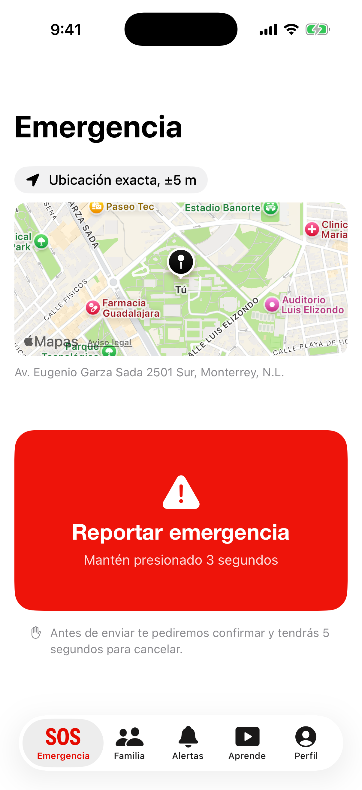
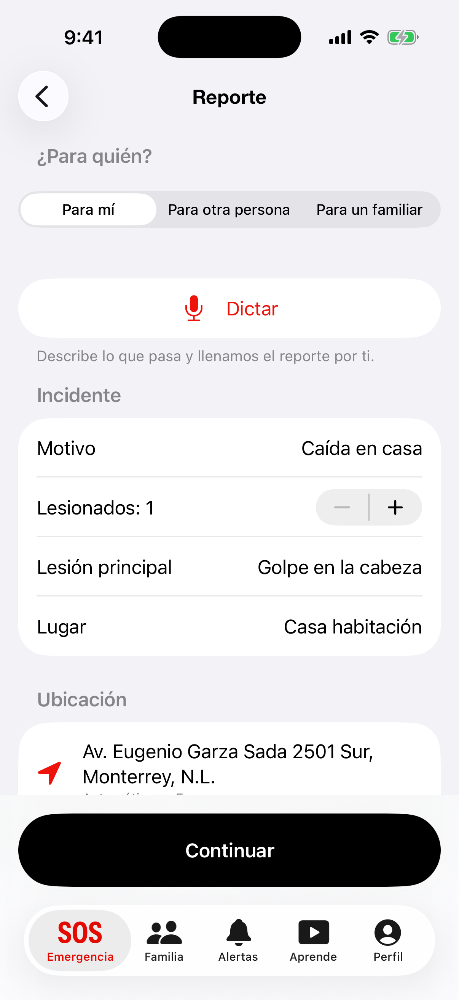
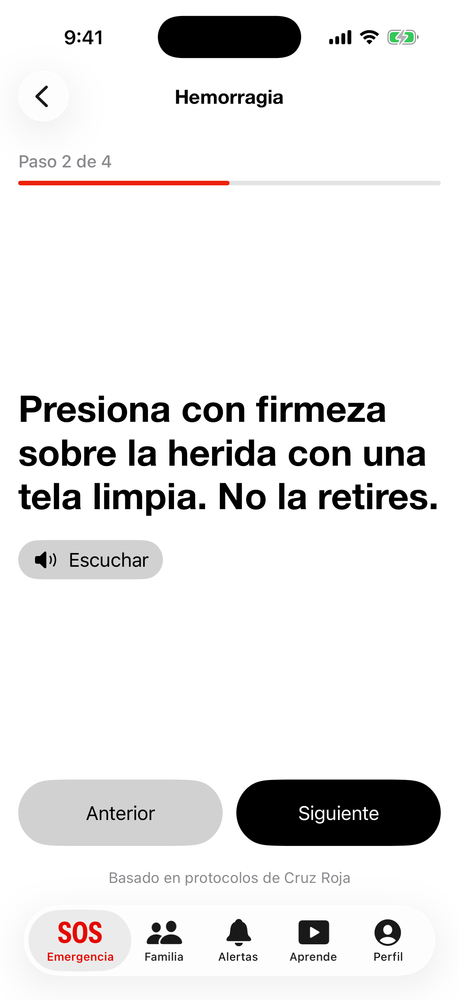
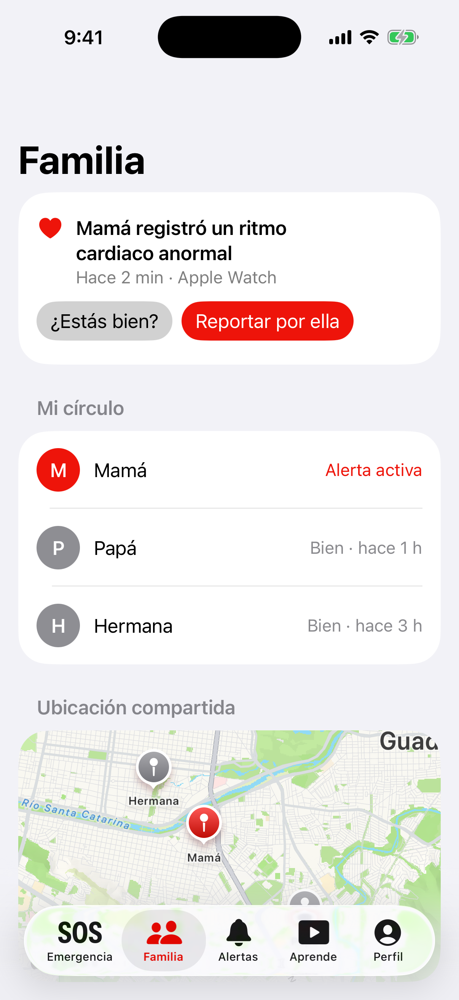
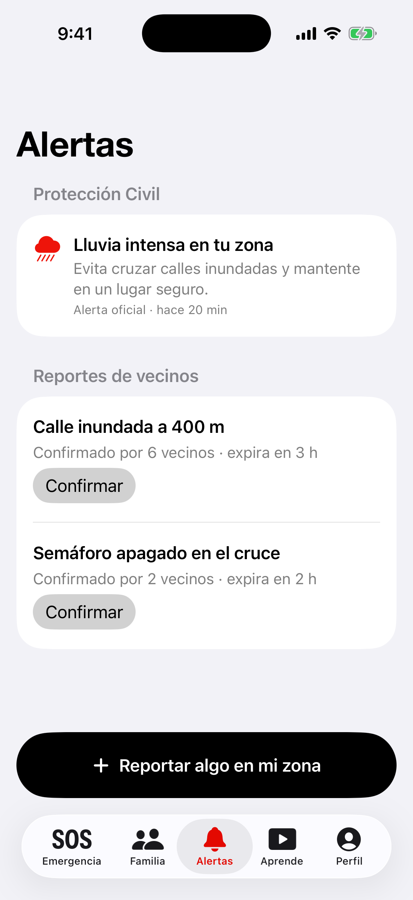
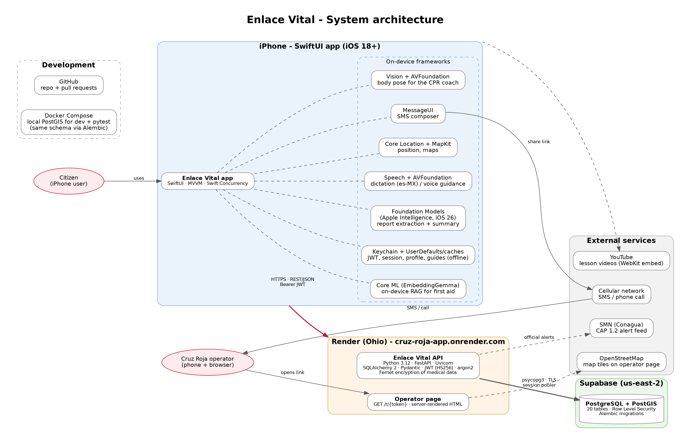
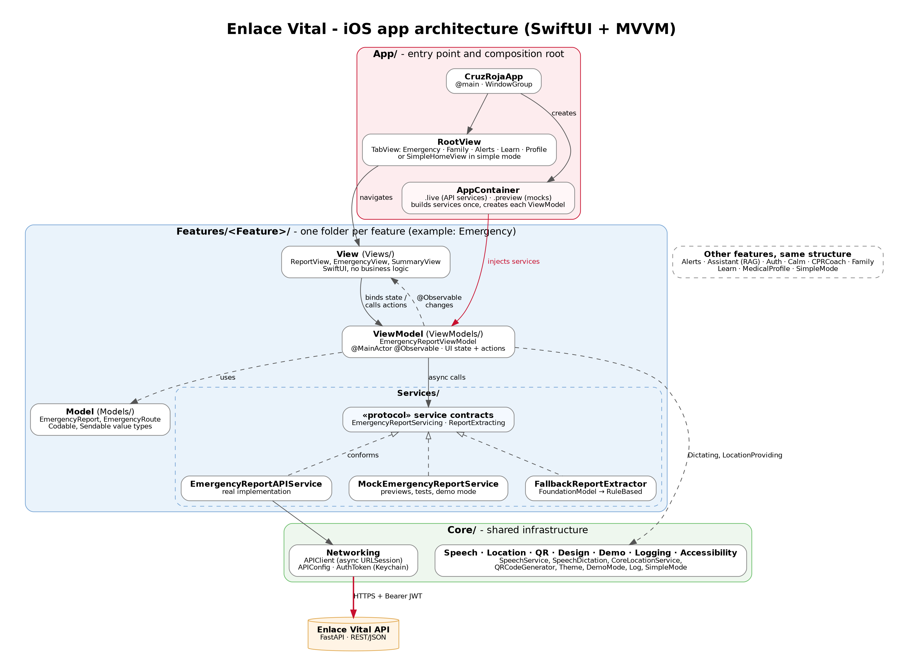

# Enlace Vital

iPhone app for Cruz Roja Mexicana that turns an emergency call into a complete, located report in under a minute.

<p align="center">
  
  
  
  
  
</p>

## The problem

During an emergency, people are nervous. They don't know the exact address, they forget what the operator needs, and the call takes minutes before anyone is dispatched. Meanwhile nobody guides them on what to do, and their family doesn't find out until much later.

## What the app does

| Feature | What it solves | Owner |
|---|---|---|
| Emergency report | Type or dictate what happens. On-device AI fills the fields Cruz Roja asks for, and the operator gets the exact location by SMS. | Fernando Hernández |
| Medical profile | Blood type, allergies and contacts travel with the report and are available to paramedics through a QR code. | Fernando Robles |
| Guided first aid and Learn | Voice instructions step by step while the ambulance arrives, plus video lessons. | Luis Rosales |
| Family circle | Shared location and an "¿Estás bien?" check after an alert. | Daniel González |
| Community alerts | Official alerts for your area and neighbor reports that others confirm. | Juan Gastelum |

## How it fits together



The iPhone app talks to a FastAPI backend over HTTPS with a JWT. The backend stores everything in PostgreSQL with PostGIS on Supabase, and medical data is encrypted. The operator doesn't install anything: they open the SMS link and see the report on a map.

## App structure

The app uses SwiftUI with MVVM and is organized by feature. Each feature has the same four folders, and `AppContainer` connects real or mock services to each screen.



```
CruzRoja/
├── App/          entry point, tabs and AppContainer
├── Core/         networking, speech, location, QR, design
└── Features/     Emergency · MedicalProfile · Assistant · Learn · Family · Alerts · Auth
    └── <Feature>/Models · Services · ViewModels · Views

backend/
├── app/routers   endpoints (controllers)
├── app/schemas   JSON validation (Pydantic)
├── app/models    tables (SQLAlchemy + PostGIS)
└── alembic/      migrations
```

## Run it

The first-aid assistant's embedding model (`CruzRoja/Resources/EmbeddingGemma.mlpackage`, 138 MB) is stored with [Git LFS](https://git-lfs.com). Install it before cloning, or run `git lfs pull` in an existing clone; without it Xcode gets a small pointer file instead of the model.

```bash
git lfs install
cp .env.example .env && docker compose up -d
cd backend && python3 -m venv .venv && source .venv/bin/activate
pip install -e ".[dev]" && alembic upgrade head && python scripts/seed.py
uvicorn app.main:app --reload
```

Then open `CruzRoja.xcodeproj` in Xcode and run the app. Tests run with Cmd + U in Xcode, and with `pytest` in `backend/` (see [backend/README.md](backend/README.md)).

## Try it

- API: https://cruz-roja-app.onrender.com (interactive docs at [`/docs`](https://cruz-roja-app.onrender.com/docs), status at [`/health`](https://cruz-roja-app.onrender.com/health)). The app already points to it in `CruzRoja/Core/Networking/APIConfig.swift`.
- Test account: `user@example.com` / `demo1234` (María López, with medical profile, family circle and a dependent).
- The free Render instance sleeps after 15 minutes without traffic; open `/health` and wait about a minute before using the app.

## Stack

| Part | Technology |
|---|---|
| iOS app | Swift 6, SwiftUI (MVVM), Foundation Models, Speech, Core Location, MapKit, Vision, Core ML, Swift Testing |
| API | Python 3.12, FastAPI, SQLAlchemy 2, GeoAlchemy2, Alembic, Pydantic, JWT, argon2, Fernet encryption, pytest |
| Database | PostgreSQL with PostGIS on Supabase (row level security on every table) |
| Hosting | Render web service for the API, Supabase for the database |

## Deploy

**Database (Supabase)**

1. Create a project at [supabase.com](https://supabase.com) and enable the `postgis` extension (Database → Extensions).
2. Copy the **Session pooler** connection string (Connect → Session pooler). Change `postgresql://` to `postgresql+psycopg://` and add `?sslmode=require`.
3. From your machine, apply the migrations:

   ```bash
   cd backend && source .venv/bin/activate
   DATABASE_URL="<pooler url>" alembic upgrade head
   ```

**API (Render)**

1. At [render.com](https://render.com), choose **New → Web Service** and connect this GitHub repository.
2. Settings:
   - Branch: `main`
   - Root directory: `backend`
   - Runtime: Python 3
   - Build command: `pip install .`
   - Start command: `uvicorn app.main:app --host 0.0.0.0 --port $PORT`
   - Region: Ohio (same as the Supabase region, `us-east-2`)
   - Instance type: Free
3. Environment variables:

   | Variable | Value |
   |---|---|
   | `DATABASE_URL` | Supabase session pooler URL from step 2 |
   | `JWT_SECRET` | Random string: `python -c "import secrets; print(secrets.token_urlsafe(48))"` |
   | `MEDICAL_DATA_KEY` | Fernet key: `python -c "from cryptography.fernet import Fernet; print(Fernet.generate_key().decode())"`. Keep it: without it the stored medical data can't be read |
   | `PUBLIC_BASE_URL` | The service URL, e.g. `https://cruz-roja-app.onrender.com` (used in the SMS link) |
   | `PYTHON_VERSION` | `3.12.8` |

4. Click **Create Web Service**. Every push to `main` deploys again.
5. Check `https://<service>.onrender.com/health` returns `{"status":"ok"}`, then set that URL as `APIConfig.baseURL` in the app.

## More

- [Architecture](docs/architecture/ARCHITECTURE.md): database, system, app and backend diagrams.
- [Emergency report](docs/emergency-report/README.md): feature flow and files.
- Test cases: `docs/TestCases_*.xlsx`.

Tecnológico de Monterrey, TC2007B, 2026.
