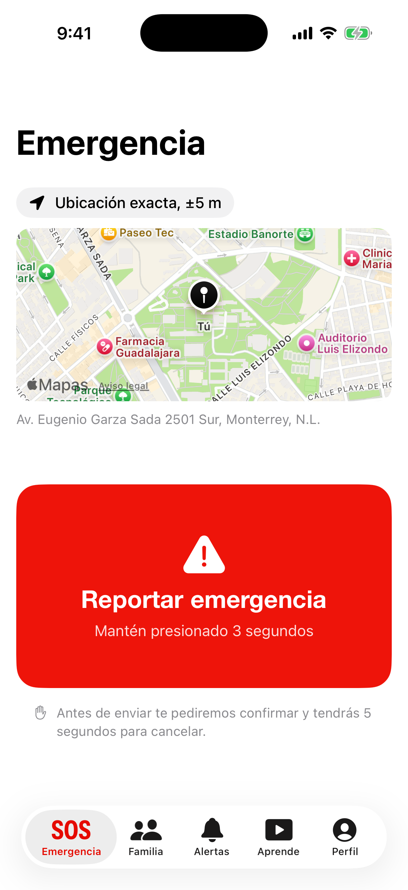
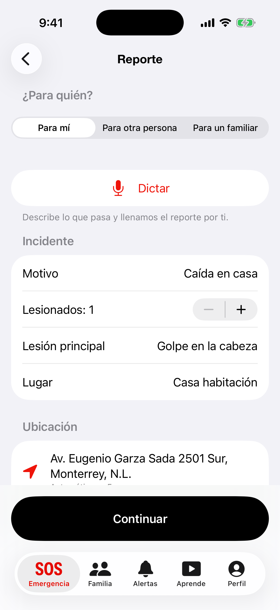
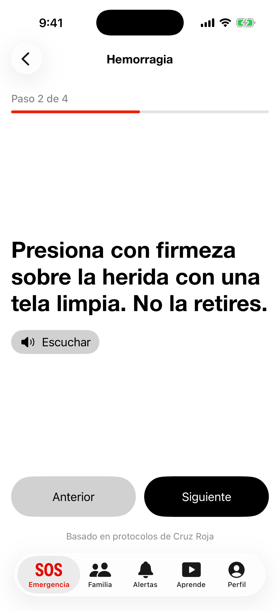
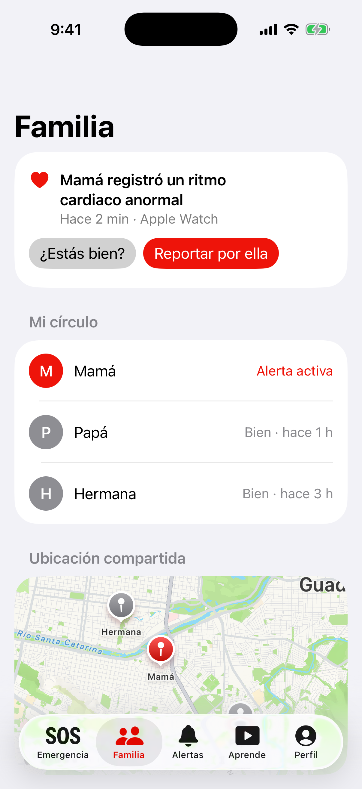
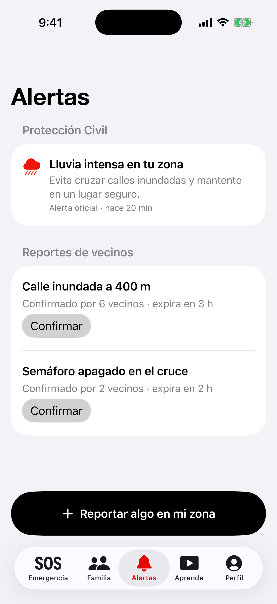

# Enlace Vital

iPhone app for Cruz Roja Mexicana that turns an emergency call into a complete, located report in under a minute.

<p align="center">
  
  
  
  
  
</p>

## The problem

During an emergency, people are nervous. They don't know the exact address, they forget what the operator needs, and the call takes minutes before anyone is dispatched. Meanwhile nobody guides them on what to do, and their family doesn't find out until much later.

## What the app does

| Feature | What it solves | Owner |
|---|---|---|
| Emergency report | Type or dictate what happens. On-device AI fills the fields Cruz Roja asks for, and the operator gets the exact location by SMS. | Fernando Hernández |
| Medical profile | Blood type, allergies and contacts travel with the report and are available to paramedics through a QR code. | Fernando Robles |
| Guided first aid and Learn | Voice instructions step by step while the ambulance arrives, plus video lessons. | Luis Rosales |
| Family circle | Shared location and an "¿Estás bien?" check after an alert. | Daniel González |
| Community alerts | Official alerts for your area and neighbor reports that others confirm. | Juan Gastelum |

## How it fits together


The iPhone app talks to a FastAPI backend over HTTPS with a JWT. The backend stores everything in PostgreSQL with PostGIS on Supabase, and medical data is encrypted. The operator doesn't install anything: they open the SMS link and see the report on a map.

## App structure

The app uses SwiftUI with MVVM and is organized by feature. Each feature has the same four folders, and `AppContainer` connects real or mock services to each screen.


```
CruzRoja/
├── App/          entry point, tabs and AppContainer
├── Core/         networking, speech, location, QR, design
└── Features/     Emergency · MedicalProfile · Assistant · Learn · Family · Alerts · Auth
    └── <Feature>/Models · Services · ViewModels · Views

backend/
├── app/routers   endpoints (controllers)
├── app/schemas   JSON validation (Pydantic)
├── app/models    tables (SQLAlchemy + PostGIS)
└── alembic/      migrations
```

## Run it

```bash
cp .env.example .env && docker compose up -d
cd backend && python3 -m venv .venv && source .venv/bin/activate
pip install -e ".[dev]" && alembic upgrade head && python scripts/seed.py
uvicorn app.main:app --reload
```

Then open `CruzRoja.xcodeproj` in Xcode and run the app. Tests run with Cmd + U in Xcode, and with `pytest` in `backend/` (see [backend/README.md](backend/README.md)).

## More

- [Architecture](docs/architecture/ARCHITECTURE.md): database, system, app and backend diagrams.
- [Emergency report](docs/emergency-report/README.md): feature flow and files.
- Test cases: `docs/TestCases_*.xlsx`.

Tecnológico de Monterrey, TC2007B, 2026.
