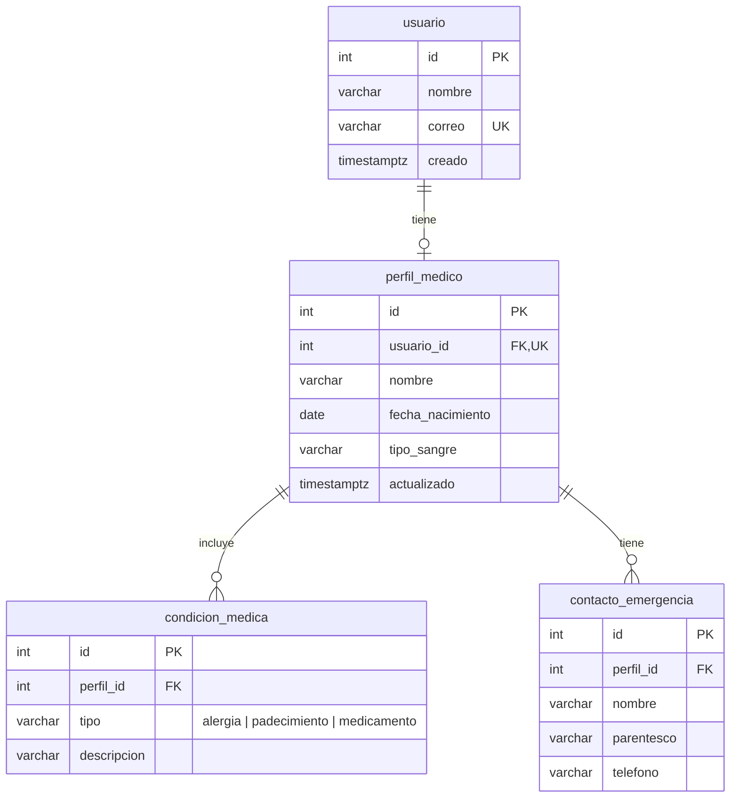

# Enlace Vital API

API del proyecto Enlace Vital para Cruz Roja Mexicana (Equipo Los Astros).

## Stack

| Parte | Tecnología |
|---|---|
| Lenguaje | Python 3.11 o más reciente |
| Framework | FastAPI |
| Base de datos | PostgreSQL 16 |
| Acceso a datos | SQLAlchemy 2.0 (ORM) |
| Validación | Pydantic 2 |
| Pruebas | pytest + TestClient de FastAPI |

## Cómo correrlo en tu computadora

1. **Levanta PostgreSQL.** La forma más fácil es con Docker:
   ```bash
   docker compose up -d
   ```
   Si ya tienes PostgreSQL instalado, crea un usuario `cruzroja` con contraseña `cruzroja` y una base `cruzroja`, o cambia `DATABASE_URL` en tu `.env`.

2. **Crea un entorno e instala dependencias:**
   ```bash
   python3 -m venv .venv
   source .venv/bin/activate
   pip install -r requirements.txt
   cp .env.example .env
   ```

3. **Crea el usuario de demostración** (id 1, con un perfil de ejemplo):
   ```bash
   python -m app.seed
   ```

4. **Inicia el API:**
   ```bash
   uvicorn app.main:app --reload
   ```
   - Revisa que funcione: http://127.0.0.1:8000/salud
   - Documentación interactiva: http://127.0.0.1:8000/docs

5. **Corre las pruebas** (usan SQLite en memoria, no necesitan PostgreSQL):
   ```bash
   pytest
   ```

> **iPhone físico:** el simulador llega a `127.0.0.1`, pero un iPhone real no. Inicia el API con `uvicorn app.main:app --host 0.0.0.0` y en la app cambia `APIConfig.baseURL` por la IP de tu Mac (por ejemplo `http://192.168.1.50:8000`).

## Estructura de carpetas

```
api/
├── app/
│   ├── main.py            Crea la app y registra los routers
│   ├── config.py          Lee DATABASE_URL del entorno
│   ├── database.py        Conexión a la base de datos y sesión por petición
│   ├── seed.py            Datos de demostración
│   ├── models/            Tablas (SQLAlchemy)
│   ├── schemas/           Formato del JSON y validaciones (Pydantic)
│   └── routers/           Endpoints, uno por módulo
├── db/schema.sql          Esquema SQL para documentación
├── tests/                 Pruebas con pytest
├── docker-compose.yml     PostgreSQL para desarrollo
└── requirements.txt
```

**Patrón:** el API sigue una separación en capas tipo MVC. `models` son los datos, `schemas` define lo que entra y sale (la "vista" en JSON) y `routers` funciona como controlador.

### Cómo agregar tu módulo

1. Crea tus tablas en `app/models/<modulo>.py` y regístralas en `app/models/__init__.py`.
2. Crea tus esquemas en `app/schemas/<modulo>.py`.
3. Crea tus endpoints en `app/routers/<modulo>.py`.
4. Agrega `app.include_router(<modulo>.router)` en `app/main.py`.
5. Agrega pruebas en `tests/test_<modulo>.py`.

## Endpoints

### Perfil médico (Fernando Robles)

| Método | Ruta | Qué hace | Respuestas |
|---|---|---|---|
| GET | `/usuarios/{usuario_id}/perfil` | Regresa el perfil médico | 200, 404 |
| PUT | `/usuarios/{usuario_id}/perfil` | Crea o reemplaza el perfil completo | 200, 404, 422 |

Ejemplo de respuesta:

```json
{
  "usuario_id": 1,
  "nombre": "María López",
  "fecha_nacimiento": "1958-03-14",
  "tipo_sangre": "O+",
  "alergias": ["Penicilina"],
  "padecimientos": ["Asma"],
  "medicamentos": ["Salbutamol"],
  "contactos": [
    { "nombre": "Ana López", "parentesco": "Hija", "telefono": "8112345678" }
  ],
  "actualizado": "2026-10-21T18:14:07Z"
}
```

Validaciones:
- `nombre` es obligatorio.
- `tipo_sangre` debe ser uno de `A+ A- B+ B- AB+ AB- O+ O- desconocido`.
- `fecha_nacimiento` no puede ser futura.
- Cada teléfono debe tener 10 dígitos. Se aceptan espacios o guiones y se guardan solo los dígitos.
- Máximo 20 elementos por lista y 5 contactos.
- Las listas se limpian: se quitan espacios, elementos vacíos y repetidos.

## Base de datos


