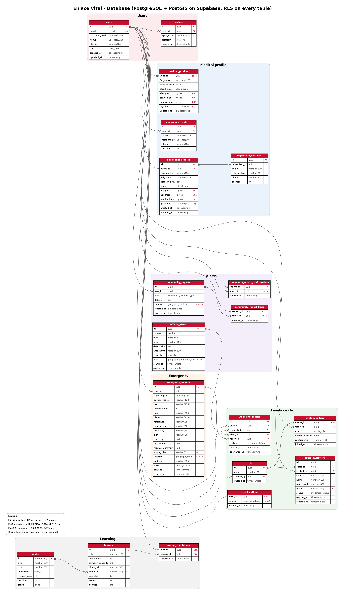
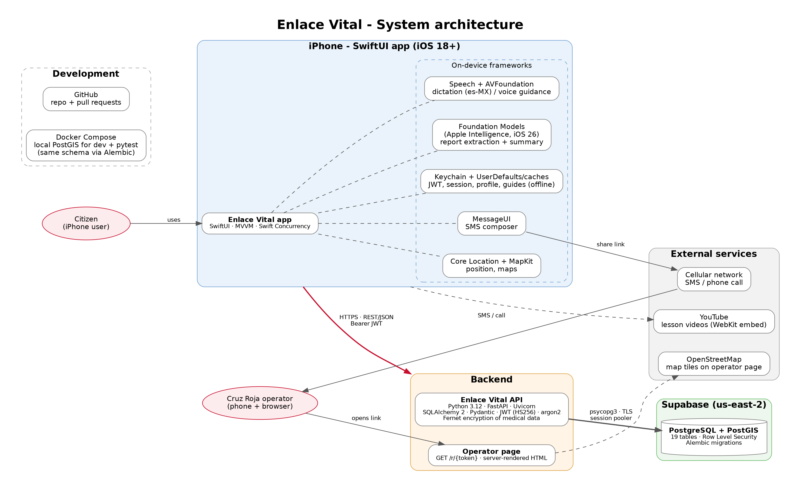
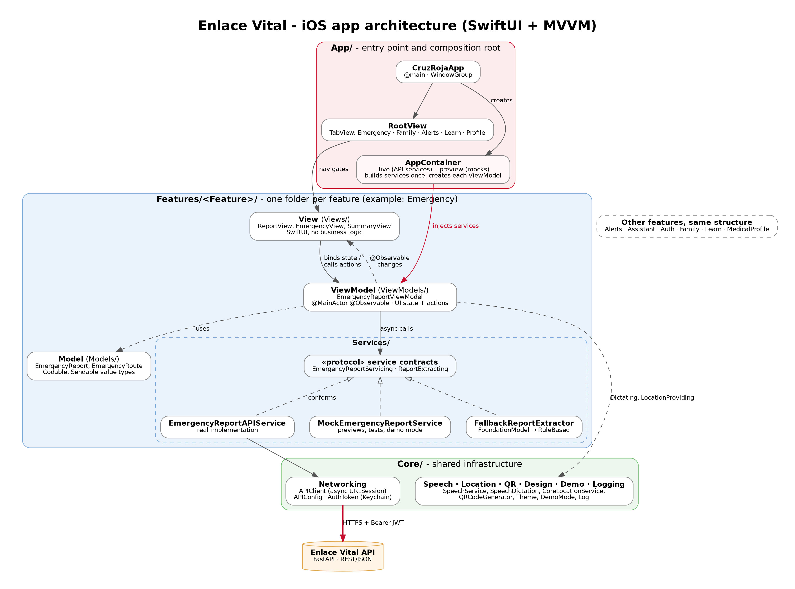
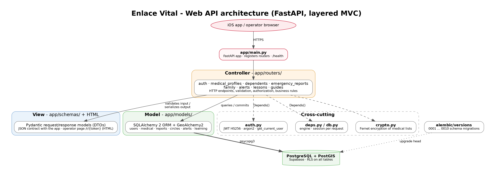
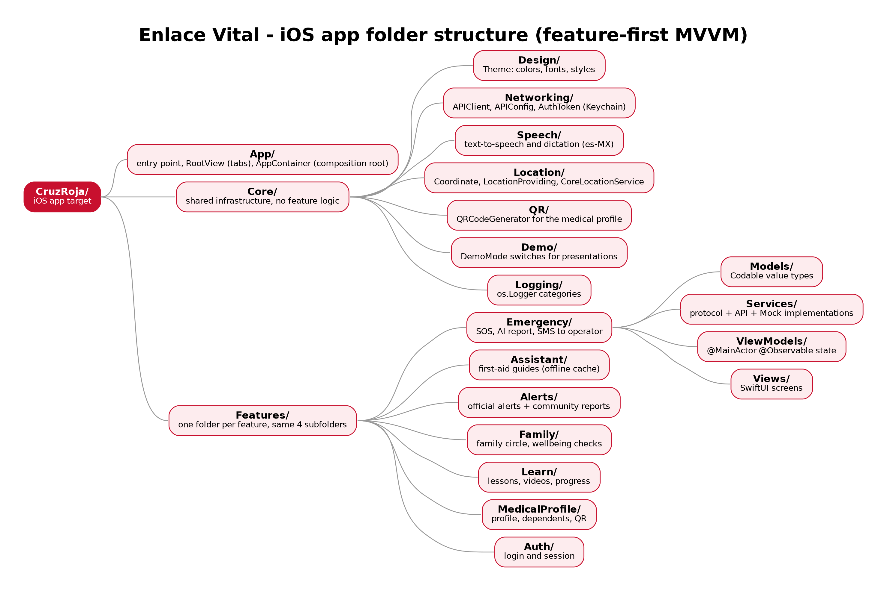
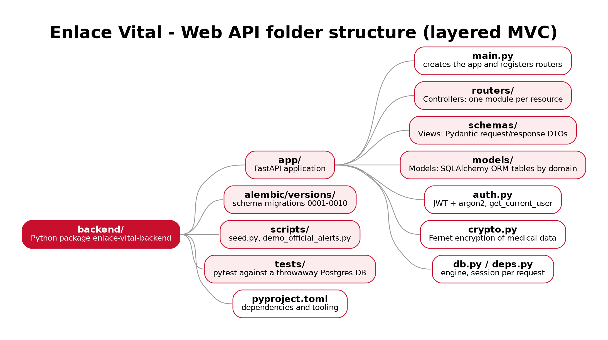

# Enlace Vital - Architecture

Architecture deliverable for Enlace Vital, the Cruz Roja Mexicana emergency app. Each diagram has an editable Graphviz source in `src/` and a rendered image in `png/`.

| # | Deliverable | Image | Source |
|---|---|---|---|
| 1 | Database design diagram | `png/01-database.png` | `src/gen_database.py` → `src/01-database.dot` |
| 2 | System architecture diagram | `png/02-system-architecture.png` | `src/02-system-architecture.dot` |
| 3 | App architecture diagram (iOS) | `png/03-app-architecture.png` | `src/03-app-architecture.dot` |
| 4 | Web API architecture diagram | `png/04-backend-architecture.png` | `src/04-backend-architecture.dot` |
| 5 | iOS folder structure | `png/05-folders-ios.png` | `src/gen_folders.py` → `src/05-folders-ios.dot` |
| 6 | Web API folder structure | `png/06-folders-backend.png` | `src/gen_folders.py` → `src/06-folders-backend.dot` |

## 1. Database design



The database runs PostgreSQL with PostGIS on Supabase. It has 19 tables grouped into six modules: Users, Medical profile, Emergency, Family circle, Alerts and Learning. `users` is the central entity, and almost every other table references it.

- **Keys.** Primary keys are UUIDs generated by the database with `gen_random_uuid()`. Join tables use composite keys: `circle_members`, `community_report_confirmations`, `community_report_flags` and `lesson_completions`.
- **Medical data.** Allergies, conditions and medications are stored as `bytea` and encrypted with Fernet (`MEDICAL_DATA_KEY`). The QR code holds only a random, revocable `qr_token`, never the data itself.
- **Locations.** Locations are PostGIS `geography` columns (SRID 4326) with GiST indexes. They are used to find official alerts and community reports near the user.
- **Access.** Row Level Security is enabled on every table (migration 0003), so the public Supabase Data API returns nothing. Only the backend reaches the data.
- **Migrations.** Alembic manages the schema, from migration 0001 to 0010.

## 2. System architecture



- **iPhone app.** It talks to the Web API over HTTPS using REST/JSON with a Bearer JWT.
- **On-device features.** Some features run entirely on the phone, so they keep working with little or no connectivity:
  - AI report filling with Apple Foundation Models, which falls back to keyword rules when the model is not available.
  - Dictation and voice guidance (Speech, AVFoundation).
  - Location and maps (Core Location, MapKit).
  - Offline guides.
- **Reaching the operator.** The app opens the SMS composer with a share link. The Cruz Roja operator opens the link in a browser and sees a server-rendered page (`/r/{token}`) with the report, the medical summary and an OpenStreetMap map.
- **Backend.** The API runs on FastAPI with Uvicorn. It connects to Supabase through the session pooler (psycopg3 over TLS).
- **Development.** Docker Compose runs a local PostGIS that uses the same Alembic schema, both for development and for the pytest database.

## 3. App architecture (iOS)



The app uses SwiftUI with **MVVM**:

- **View.** Draws the UI and holds no business logic.
- **ViewModel.** `@MainActor @Observable`. It holds the screen state and exposes actions as `async` functions.
- **Model.** Plain `Codable` and `Sendable` value types.
- **Services.** Each service is a protocol with two implementations: an API one and a Mock. ViewModels depend only on the protocol, so the same screen can run against the real API, against mocks in previews and tests, or in demo mode.
- **AppContainer.** This is the composition root. It builds every service once (`.live` uses the real API and `.preview` uses mocks) and injects them into each ViewModel.
- **Core.** Shared infrastructure: networking, speech, location, QR, design, demo mode and logging.

## 4. Software architecture per component

| Component | Architecture | Why |
|---|---|---|
| iOS app (SwiftUI) | **MVVM** with protocol-based services and a composition root (`AppContainer`) | SwiftUI binds directly to `@Observable` ViewModels. Protocols allow mocks for previews, tests and demos. |
| Web API (FastAPI) | **Layered MVC**: routers = Controllers, Pydantic schemas = Views (JSON), SQLAlchemy models = Models | Keeps HTTP, contract and persistence separate, and each resource gets its own module. |
| Operator page (`/r/{token}`) | **Server-rendered HTML** served by the API | Works in any browser with no install and no login. Access requires the random token. |
| Database (Supabase) | **Relational with PostGIS** and Row Level Security, versioned with Alembic | Gives integrity through FKs, geographic queries, and lockdown of the public Data API. |
| AI report filling | **Strategy with fallback**: `FallbackReportExtractor` uses `FoundationModelReportExtractor` when available, otherwise `RuleBasedReportExtractor` | Keeps data private on the device and always gives a result. |



A request goes through these steps:

1. `main.py` routes it to a router (Controller).
2. The router resolves its dependencies (`get_current_user`, the DB session) with `Depends()`.
3. The router validates the body with a Pydantic schema.
4. The router reads or writes ORM models, decrypting or encrypting medical data with `crypto.py` when needed.
5. The router returns a response schema, which is the JSON view.

## 5. Folder structure

### Repository

```
Cruz-Roja-App/
├── CruzRoja/              # iOS app sources (SwiftUI)
├── CruzRoja.xcodeproj/    # Xcode project
├── CruzRojaTestsAprende/  # iOS unit tests
├── backend/               # Web API (FastAPI)
├── docs/                  # test cases, screenshots, this document
└── docker-compose.yml     # local PostGIS for development
```

### iOS app: feature-first MVVM



```
CruzRoja/
├── App/                 # CruzRojaApp, RootView (tabs), AppContainer
├── Core/                # shared infrastructure
│   ├── Design/          # Theme
│   ├── Networking/      # APIClient, APIConfig, AuthToken (Keychain)
│   ├── Speech/          # SpeechService, SpeechDictation
│   ├── Location/        # LocationProviding, CoreLocationService
│   ├── QR/              # QRCodeGenerator
│   ├── Demo/            # DemoMode
│   └── Logging/         # Log
└── Features/
    ├── Emergency/       # every feature has the same four folders:
    │   ├── Models/
    │   ├── Services/    # protocol + API + Mock
    │   ├── ViewModels/
    │   └── Views/
    ├── Assistant/
    ├── Alerts/
    ├── Family/
    ├── Learn/
    ├── MedicalProfile/
    └── Auth/
```

Code is grouped by feature first and by layer second. Everything for one feature lives in one folder, and code shared between features goes in `Core/`.

### Web API: layered MVC



```
backend/
├── app/
│   ├── main.py          # FastAPI app, registers routers
│   ├── routers/         # Controllers (auth, medical_profiles, dependents, emergency_reports, family, alerts, lessons, guides)
│   ├── schemas/         # Views: Pydantic DTOs
│   ├── models/          # Models: SQLAlchemy ORM (users, medical, reports, circles, alerts, learning)
│   ├── auth.py          # JWT + argon2
│   ├── crypto.py        # Fernet encryption
│   ├── db.py, deps.py   # engine and session per request
├── alembic/versions/    # migrations 0001-0010
├── scripts/             # seed and demo data
├── tests/               # pytest
└── pyproject.toml
```

## Regenerating the images

```bash
cd docs/architecture/src
python3 gen_database.py > 01-database.dot
python3 gen_folders.py
for f in *.dot; do dot -Tpng -Gdpi=200 "$f" -o "../png/${f%.dot}.png"; done
```
