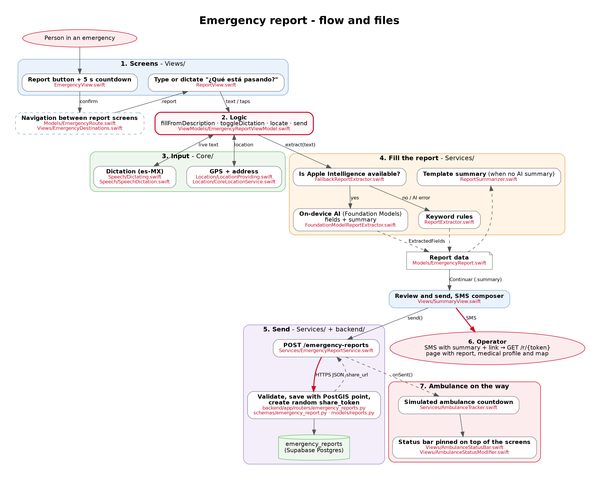

# Emergency report

Owner: Fernando Hernández Cantú

A person reports an emergency, for themselves or someone else, by typing or dictating. The on-device AI fills the fields Cruz Roja asks for and writes a short summary. The operator receives the exact location by SMS with a link.



## How it works

1. **Report.** `EmergencyView` asks for confirmation and runs a 5-second countdown to cancel. `ReportView` takes the description, typed or dictated in Spanish (`SpeechDictation`).
2. **Fill.** `EmergencyReportViewModel.fillFromDescription()` calls a `ReportExtracting`:
   - `FallbackReportExtractor` checks whether Apple Intelligence is available.
   - If it is, `FoundationModelReportExtractor` fills a `@Generable ReportDraft`, where `@Guide` limits each field to the valid options, and writes the summary. All of this runs on the iPhone.
   - If not, `RuleBasedReportExtractor` fills the fields with Spanish keywords and the screen says why the AI was not used.
3. **Locate.** `CoreLocationService` returns one GPS fix and its address.
4. **Send.** `SummaryView` calls `send()`. `EmergencyReportAPIService` posts to `POST /emergency-reports`, attaching the medical profile when the report is for the user.
5. **Store.** The API validates the body (`EmergencyReportIn`) and saves it in `emergency_reports` with a PostGIS point. It then creates a random `share_token` and returns `share_url`.
6. **Operator.** The app opens the SMS composer with the summary and the link. `GET /r/{token}` shows the report, the medical profile and an OpenStreetMap map.
7. **Ambulance.** After sending, `onSent()` starts `AmbulanceTracker`, and `AmbulanceStatusBar` shows the time left on top of the following screens.

## Files

| Layer | Files |
|---|---|
| Model | `CruzRoja/Features/Emergency/Models/EmergencyReport.swift`, `Models/EmergencyRoute.swift` |
| Screens | `Views/EmergencyView.swift`, `Views/ReportView.swift`, `Views/SummaryView.swift`, `Views/EmergencyDestinations.swift` (navigation) |
| Ambulance | `Services/AmbulanceTracker.swift`, `Views/AmbulanceStatusBar.swift`, `Views/AmbulanceStatusModifier.swift` |
| Logic | `ViewModels/EmergencyReportViewModel.swift` |
| AI and rules | `Services/FallbackReportExtractor.swift`, `Services/FoundationModelReportExtractor.swift`, `Services/ReportExtractor.swift`, `Services/ReportSummarizer.swift` |
| Network | `Services/EmergencyReportService.swift` |
| Dictation and GPS | `CruzRoja/Core/Speech/SpeechDictation.swift`, `CruzRoja/Core/Location/CoreLocationService.swift` |
| Wiring | `CruzRoja/App/AppContainer.swift` (`makeEmergencyReportViewModel`) |
| Backend | `backend/app/routers/emergency_reports.py`, `schemas/emergency_report.py`, `models/reports.py`, migration `0004_emergency_report_sharing.py` |
| Tests | `backend/tests/test_emergency_reports.py` |

## Design decisions

- **Privacy.** The AI runs on the device, so the description never leaves the phone to be processed.
- **Fallback.** Keyword rules make sure the report still works without Apple Intelligence.
- **Protocols.** Each service has an API version and a Mock, so the screens work in previews and tests without a backend.
- **Operator link.** The link uses a random token, and the operator needs no app or login.

## Try it

```bash
docker compose up -d
cd backend && alembic upgrade head && uvicorn app.main:app --reload
```

Run the app from Xcode. For the AI, use Xcode 26 with an iOS 26 simulator on a Mac with Apple Intelligence, or an iPhone 15 Pro or newer.
